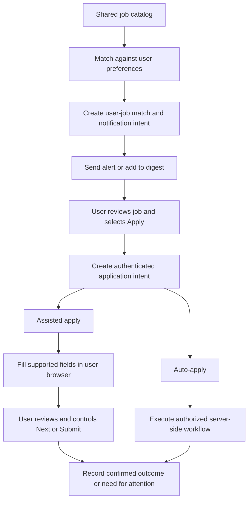

# Tsenta: Job Alerts and Application Workflows

Technical proposal for matching-job notifications, user-controlled application assistance, and a unified Apply workflow. The components and interfaces below describe proposed behavior, not an implemented system.

## 1. Problems and observations

The observations refer to the user-facing workflow encountered during use. They do not establish the behavior of every account, the internal implementation, or the product roadmap.

| Observation or requirement | Technical problem |
| --- | --- |
| Matching recommendations are encountered when the user opens the application. | A pull-only discovery flow requires repeated visits to notice new opportunities. |
| Some applications need review of answers and user control over navigation and submission. | An automated submission flow alone does not cover a workflow where the user wants to approve each page. |
| The apply externally is no longer visible in the recent update (atleast for me) , while the recommendations API remains accessible to the authenticated user. | Removing a UI control does not determine which data an API exposes or how application actions are authorized. |
| A job can appear in multiple searches or recommendation refreshes. | Notifications and application attempts need persistent identities to prevent duplicate work. |

## 2. Proposal

Create a personal job pipeline for each user, backed by a shared job catalog:

1. Detect new matches against the user's preferences.
2. Send a notification or include the match in a digest.
3. Let the user review the job and select **assisted apply** or **auto-apply**.
4. Resolve the application destination when the authenticated Apply action begins.
5. Track progress and record a confirmed outcome or a need for attention.

The personal pipeline stores user-specific state. It does not require independently collecting the same jobs or provisioning a separate worker for every account.

## 3. Solution workflow

## 4. Technical design

### Shared catalog and per-user state

The following are logical records; they do not prescribe a database or Tsenta's current storage schema.

| Record | Purpose and key fields |
| --- | --- |
| Job | Shared job ID, source identity, destination URL, content revision, posting time when known, and discovery time. |
| User preferences | Matching filters, notification mode, channel, schedule and quiet hours. |
| User-job match | Unique user/job pair, first-match time, preference revision, match explanation, and saved/dismissed state. |
| Notification event | Stable logical alert ID, user/job reference, event type, delivery attempts and delivery outcome. |
| Application attempt | Attempt ID, user/job reference, selected mode, current step, execution state and submission evidence. |

Job content is shared. Matches, notification history and application attempts are scoped to the user. Access checks must enforce that ownership.

### Matching-job notifications

1. Process new or changed catalog records against user preferences.
2. Create or update the user-job match.
3. When a match qualifies for an alert, persist the match transition and notification intent atomically.
4. Deliver notifications asynchronously according to the user's channel, digest and quiet-hour settings.
5. Record delivery outcomes and retry transient failures with bounded backoff.

A notification includes the title, company, location, posting date when known, match explanation and a link to review the job in Tsenta.

Use a stable identity for each logical alert so repeated ingestion, overlapping searches and retries do not create independent copies. Use delivery-provider idempotency where supported. A delivery timeout can leave the outcome unknown; it must not be treated as proof that nothing was sent.

Keep the following events distinct:

- **Newly posted:** supported by the source posting date.
- **Newly discovered:** first observed in the shared catalog.
- **Newly matched:** first qualifies for a user's preferences.
- **Updated:** an existing posting changed.

Initial synchronization establishes a baseline, with an optional initial digest. Preference changes use an explicit re-notification policy rather than automatically treating every existing match as a new posting.

### Assisted application

Assisted mode runs through a browser extension or another supported local-browser integration. Begin with one ATS workflow and expand after validating field mappings, navigation and outcome detection.

1. The user selects a job and starts assisted mode.
2. The application intent is authenticated and checked for ownership.
3. The browser opens the application destination and fills supported fields using authorized profile data.
4. The user reviews and edits the current page, then clicks **Next**.
5. Assistance continues after the next supported page loads.
6. The user reviews the completed application and clicks **Submit**.

The automation does not advance pages or submit on the user's behalf in this mode. User edits take precedence over autofill. Provide visible progress and a stop control.

Pause for missing answers, ambiguous questions, login, verification, or unsupported pages. Persist enough progress to resume without overwriting user corrections or creating duplicate application attempts.
